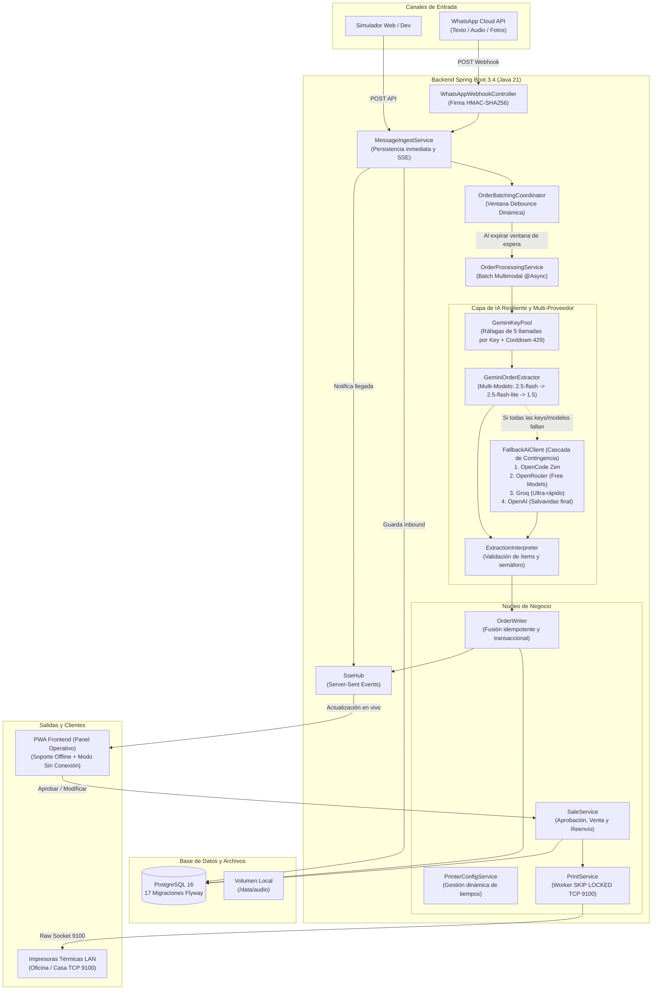

# 🥑 FruverCopilot — Documentación Completa del Sistema

Bienvenido a la documentación oficial y guía de referencia de **FruverCopilot**, el sistema integral de recepción de pedidos, procesamiento con Inteligencia Artificial, gestión de comandas e impresión térmica para distribuidoras y tiendas de frutas y verduras (Fruver).

---

## 📑 Tabla de Contenidos

1. [Visión General y Filosofía del Sistema](#1-visión-general-y-filosofía-del-sistema)
2. [Arquitectura Técnica](#2-arquitectura-técnica)
3. [Flujos Operativos](#3-flujos-operativos)
   - [3.1. Flujo Mayorista (Recepción Ágil y Comandas)](#31-flujo-mayorista-recepción-ágil-y-comandas)
   - [3.2. Flujo Minorista (Cotización y Catálogo Estricto)](#32-flujo-minorista-cotización-y-catálogo-estricto)
   - [3.3. Procesamiento Multimodal: Texto, Audio y Fotos](#33-procesamiento-multimodal-texto-audio-y-fotos)
4. [Instalación y Configuración](#4-instalación-y-configuración)
   - [4.1. Requisitos Previos](#41-requisitos-previos)
   - [4.2. Variables de Entorno (.env)](#42-variables-de-entorno-env)
   - [4.3. Despliegue con Docker](#43-despliegue-con-docker)
5. [Manual del Operador (PWA)](#5-manual-del-operador-pwa)
   - [5.1. Instalación en Celulares (Android / iOS) y PC](#51-instalación-en-celulares-android--ios-y-pc)
   - [5.2. Tablero de Pedidos en Vivo](#52-tablero-de-pedidos-en-vivo)
   - [5.3. Revisión, Anexado y Edición Manual](#53-revisión-anexado-y-edición-manual)
   - [5.4. Gestión de Clientes, Precios, Repartidores e Impresoras](#54-gestión-de-clientes-precios-repartidores-e-impresoras)
6. [Sistema de Impresión Térmica](#6-sistema-de-impresión-térmica)
   - [6.1. Protocolo ESC/POS y Red Local](#61-protocolo-escpos-y-red-local)
   - [6.2. Múltiples Impresoras y Reglas Horarias](#62-múltiples-impresoras-y-reglas-horarias)
   - [6.3. Formato del Ticket](#63-formato-del-ticket)
7. [Integración con WhatsApp Cloud API](#7-integración-con-whatsapp-cloud-api)
8. [Modelo de Datos y Base de Datos (PostgreSQL)](#8-modelo-de-datos-y-base-de-datos-postgresql)
9. [Pruebas, Auditoría y Mantenimiento](#9-pruebas-auditoría-y-mantenimiento)

---

## 1. Visión General y Filosofía del Sistema

FruverCopilot está diseñado bajo un principio fundamental:

> **El software es un sistema ágil para RECIBIR pedidos, NO un POS rígido para interrogar clientes.**

### ¿Por qué este enfoque?
En el comercio de frutas y verduras (especialmente mayoristas y restaurantes), los clientes piden con lenguaje coloquial (*"cabezona"*, *"de la larga"*, *"2 de cilantro"*, *"10 de papa"*), o envían fotos de notas manuscritas en libretas. 

- **Cero fricción:** El sistema **nunca interroga al cliente** preguntándole si se refería a kilos o libras ni exigiendo variedad botánica exacta.
- **Respeto al conocimiento del negocio:** Los operarios ya conocen a sus clientes y sus hábitos de compra.
- **IA que asiste sin estorbar:** La IA extrae los productos exactamente como los dijo el cliente, calcula las cantidades dadas y deja los espacios necesarios para que el operario complete a mano los datos en la comanda física impresa o en el tablero.

---

## 2. Arquitectura Técnica

FruverCopilot está construido con una arquitectura desacoplada, reactiva y orientada a la confiabilidad operacional:



### Componentes Clave:
- **Backend:** Java 21, Spring Boot 3.4, Spring Security, Spring Web, `JdbcClient` (SQL nativo optimizado sin sobrecarga de JPA/Hibernate).
- **Base de Datos:** PostgreSQL 16 con extensiones `pg_trgm` (búsqueda difusa) y `unaccent` (búsqueda sin tildes). Migraciones gestionadas por **Flyway** (17 versiones).
- **Frontend / PWA:** Single-Page Application ultra-ligera en JavaScript nativo (`index.html`, `sw.js`, `manifest.json`), con modo offline tolerante a fallos de conexión y Server-Sent Events (SSE).
- **Seguridad:** Autenticación de sesiones con Cookies HTTP-Only, `SameSite=Lax`, CSRF con token rotativo, rate-limiting contra ataques de fuerza bruta (bloqueo tras 5 intentos fallidos en 10 minutos), headers CSP y firmas HMAC para webhooks de WhatsApp.

---

## 3. Flujos Operativos

### 3.1. Flujo Mayorista (Recepción Ágil, Ventas y Comandas)

Es el modo por defecto (`AUTO_PRINT_WHOLESALE=true`):

1. **Recepción del Mensaje/Foto:** El cliente envía su lista por WhatsApp (por ejemplo, una foto de una comanda manuscrita o un mensaje de texto como `"deme 2 de la larga y 20 de papa"`).
2. **Anexado Continuo dentro del Margen de 5 Minutos:** 
   - Mientras la orden no se haya impreso y el cliente continúe enviando mensajes o fotos dentro del margen de **5 minutos** (`WHOLESALE_GRACE_SECONDS=300`), todos los ítems se acumulan y fusionan en la misma comanda.
3. **Auto-Aprobación e Impresión Térmica:**
   - Una vez transcurridos los 5 minutos sin nuevas adiciones (o si el operario presiona *"MARCAR COMO VENDIDO"* en cualquier momento), la orden se aprueba, genera la comanda y se envía a la impresora térmica.
4. **Facturas Impresas se Consideran VENDIDAS:**
   - Al imprimirse con éxito en papel, la factura queda marcada con el badge destacado **`✅ VENDIDA (🖨️ IMPRESO EN ...)`**.
5. **Nuevos Pedidos vs. Anexado Opcional:**
   - Si el cliente vuelve a escribir después de los 5 minutos (es decir, cuando su factura ya fue impresa/vendida), el mensaje ingresa automáticamente como una **NUEVA FACTURA**.
   - El operario puede:
     - Dejarlo como nueva factura independiente para facturarla por separado.
     - O si lo desea, pulsar **`➕ Anexar a Pedido #...`** para consolidarla con la venta anterior.
     - Desde la tarjeta de una venta ya impresa, el operario también cuenta con el botón **`➕ Agregar más cosas`** para reabrirla y agregar productos si el cliente solicita adiciones de última hora.
6. **Comanda con Espacios Manuales:**
   - El ticket se imprime con el nombre literal, cantidades reconocidas, casillas en blanco para la unidad `[    ]` y espacios para el valor `$ [        ]`.
   - El personal de alistamiento y despacho completa a mano los detalles que conoce del cliente.

### 3.2. Flujo Minorista (Cotización y Catálogo Estricto)

Cuando se opera en modo minorista (`AUTO_PRINT_WHOLESALE=false`):

1. Cada producto se coteja contra el catálogo y listas de precios vigentes (`product_price`).
2. Si faltan unidades o hay ambigüedad, el semáforo marca `YELLOW` o `RED` para que el cajero revise en pantalla.
3. El cajero o la IA pueden generar cotizaciones exactas con subtotales y enviarlas al cliente por WhatsApp.
4. La venta solo se genera cuando el cajero presiona **"Aprobar y Facturar"**. Si el cliente escribe después de aprobada, la PWA muestra un aviso destacado: *"Este cliente tiene un pedido aprobado pendiente de despacho"* con un botón para **Anexar**.

### 3.3. Procesamiento Multimodal: Texto, Audio y Fotos

- **Mensajes de Texto:** Limpieza de caracteres, búsqueda difusa en catálogo e interpretación rápida.
- **Notas de Voz (Audios):** Descarga segura de los servidores de WhatsApp, almacenamiento en `/data/audio`, transcripción con **Whisper** y vinculación del audio a la orden (el operario puede escucharlo directamente en la PWA con el reproductor integrado).
- **Fotos de Listas/Libretas:** Descarga de la imagen, almacenamiento seguro y procesamiento con **Gemini Vision OCR** especializado en caligrafía colombiana de fruver. La foto se puede ampliar y revisar en cualquier momento desde el botón **"Ver Foto de Lista"**.

### 3.4. Resiliencia de IA: Pool Multi-Clave, Debounce y Cascada de Contingencia

Para blindar la operación contra caídas de proveedores o bloqueos por saturación (HTTP 429), el sistema opera con una arquitectura de alta disponibilidad:

1. **Pool de Claves Gemini con Balanceo por Ráfagas (Batch Rotation):**
   - Soporta $N$ claves de Google Gemini de cuentas diferentes (`GEMINI_API_KEYS=key1,key2,key3`).
   - Realiza **5 llamadas seguidas por clave** (0-4 en Key #1, 5-9 en Key #2, 10-14 en Key #3) para balancear la carga de forma uniforme y tolerable.
   - **Tolerancia a 429:** Si una clave recibe un límite de tasa (HTTP 429), entra inmediatamente en **cooldown de 60 segundos** y el sistema salta a la siguiente clave sana sin esperar.
2. **Degradación Multi-Modelo en Cascada:**
   - Si un modelo de Gemini devuelve `404` (no encontrado) o `503` (sobrecargado), el sistema desciende en automático al siguiente modelo de menor demanda:
     $$\text{gemini-2.5-flash} \longrightarrow \text{gemini-2.5-flash-lite} \longrightarrow \text{gemini-2.0-flash} \longrightarrow \text{gemini-1.5-flash}$$
3. **Cascada de 4 Proveedores Cloud de Respaldo (`FallbackAiClient`):**
   - Si todas las claves y modelos de Gemini se agotan o Google sufre una caída global, la orden se redirige de inmediato a los siguientes respaldos en orden:
     1. **OpenCode Zen:** Modelos libres (`deepseek-v4.1-flash-free`, `mimo-v2.6-flash-free`).
     2. **OpenRouter:** Modelos gratuitos activos (`nvidia/nemotron-3.5-lightning:free`, `google/gemma-4-26b-a4b-it:free`).
     3. **Groq Cloud:** Inferencia ultra-rápida en hardware LPU (`openai/gpt-oss-120b`, `qwen/qwen3.8-27b`).
     4. **OpenAI:** Salvavidas pagado final (`gpt-4o-mini`).
4. **Debounce y Batching Multimodal (Audio + Foto + Texto):**
   - Si un cliente envía una ráfaga (ej: 1 audio, luego 1 foto de libreta, luego 1 texto aclaratorio, luego otra foto), el `OrderBatchingCoordinator` abre una ventana de espera (por defecto 20s).
   - Todos los medios se consolidan y se envían en una **única llamada multimodal (`extractBatch`)**, consumiendo 1 solo token batch y manteniendo todo el contexto unificado.

### 3.5. Capacidad Cuantitativa: ¿Cuánto aguantan realmente las IAs?

| Proveedor / Mecanismo | Límite por Minuto (RPM) | Límite Diario (RPD) | Capacidad Máxima |
|---|---|---|---|
| **Gemini (Pool de 3 Claves Free)** | 15 RPM × 3 = **45 RPM** | 1.500 RPD × 3 = **4.500 pedidos/día** | ~135.000 pedidos/mes (Gratis) |
| **Groq (Inferencia Ultra-Rápida)** | **30 RPM** | **14.400 pedidos/día** | ~432.000 pedidos/mes (Gratis) |
| **OpenRouter (:free models)** | Variable (10-20 RPM) | Cuota dinámica comunitaria | Respaldo adicional |
| **Total Combinado de Contingencia** | **75+ pedidos por minuto** | **> 18.000 pedidos diarios** | Alta escala |

#### ¿Qué significa esto para una operación de 500 clientes/día?
- Un fruver que atiende **500 clientes diarios** genera aproximadamente 500 llamadas de IA gracias a la consolidación de ráfagas (Debounce).
- Con solo el pool de 3 claves de Gemini (**4.500 pedidos/día**), los 500 pedidos consumen apenas el **11.1% de la cuota diaria**.
- En horas pico (ej: 7:00 AM a 9:00 AM, 150 clientes en 2 horas), la tasa promedio es de **1.25 pedidos por minuto**, muy por debajo del techo de **45 pedidos por minuto**.
- Por lo tanto, el sistema cuenta con un margen de seguridad de **36x sobre el pico normal de operación**.

### 3.6. ¿Qué ocurre si fallan TODAS las IAs (Apagón Total)?

Si se cortara la conexión a Internet o todos los proveedores de IA cayeran simultáneamente:
1. **Cero Pérdida de Datos:** Ni el audio, ni las fotos, ni los mensajes de texto se descartan. Todo queda persistido en PostgreSQL y en el disco local `/data/audio`.
2. **Bandera de Revisión Inmediata:** La orden se marca con `status = 'REVIEW'`, `ai_status = 'FAILED'` y nota visible: *"IA no disponible; digitar el pedido manualmente"*.
3. **Operación Continua:** En el tablero operativo de la PWA, la tarjeta del cliente aparece en color de advertencia con el botón **"Ver Foto de Lista"** y el reproductor de audio, permitiendo al cajero ingresar los productos manualmente en 10 segundos y facturar sin detener la venta.

### 3.7. Gestión Dinámica de Tiempos de Espera desde la PWA

Desde la pantalla de **Configuración** (`/configuracion`), el administrador puede ajustar en caliente y sin reiniciar el servidor:
- **Tiempo de espera antes de enviar a la IA (Ráfagas):** Segundos que espera el sistema tras recibir un mensaje de WhatsApp para agrupar mensajes continuos (por defecto 20s).
- **Tiempo de espera para hacer pedido / adición:** Margen en minutos para que el cliente mayorista agregue más cosas antes de cerrar la factura (por defecto 5 min).
- **Tiempo de espera de impresora:** Segundos máximos de conexión LAN TCP 9100 (por defecto 5s).
- **Impresión automática al vencer el tiempo de espera:** Switch ON/OFF.

---

## 4. Instalación y Configuración

### 4.1. Requisitos Previos

- **Docker** y **Docker Compose v2** instalados.
- Equipo o servidor ubicado en la **misma red local** de las impresoras térmicas (para que el contenedor alcance el puerto TCP 9100).
- Conexión a Internet para la API de IA (Google Gemini o OpenAI) y el webhook de WhatsApp.

### 4.2. Variables de Entorno (.env)

Copia el archivo de ejemplo y ajusta tus credenciales:

```bash
cp .env.example .env
```

| Variable | Descripción | Valor Recomendado |
|---|---|---|
| `SPRING_PROFILES_ACTIVE` | Perfil de ejecución (`dev` o `prod`) | `prod` (en producción) |
| `APP_PORT` | Puerto HTTP donde responderá FruverCopilot | `8085` |
| `DB_PASSWORD` | Contraseña de PostgreSQL | Contraseña segura aleatoria |
| `ADMIN_PASSWORD` | Contraseña del usuario administrador (`admin`) | Contraseña segura |
| `OPERATOR_PASSWORD` | Contraseña del cajero/operador (`operador`) | Contraseña segura |
| `GEMINI_API_KEY` | Clave de Google Gemini (recomendado para fotos y texto) | `AIzaSy...` |
| `OPENAI_API_KEY` | Clave de OpenAI (opcional para Whisper o GPT-4o) | `sk-...` |
| `AUTO_PRINT_WHOLESALE` | Auto-aprobación e impresión mayorista | `true` |
| `WHOLESALE_GRACE_SECONDS`| Segundos de espera por adiciones antes de imprimir | `300` (5 minutos) |
| `PRINTER_ENABLED` | Activar impresión en papel | `true` (o `false` para pruebas en log) |
| `PRINTER_HOST` | IP de la impresora principal | `192.168.1.200` |
| `PRINTER_PORT` | Puerto RAW ESC/POS | `9100` |
| `WHATSAPP_ENABLED` | Habilitar integración de WhatsApp Cloud API | `true` |
| `WHATSAPP_VERIFY_TOKEN` | Token para validar webhook en Meta | Token aleatorio largo |
| `WHATSAPP_APP_SECRET` | Secreto de la aplicación en Meta | Clave secreta de Meta |
| `WHATSAPP_ACCESS_TOKEN` | Token de acceso del número de WhatsApp | Token permanente de Meta |

### 4.3. Despliegue con Docker

1. **Construir y levantar el sistema:**
   ```bash
   docker compose up -d --build
   ```
2. **Verificar estado de los contenedores:**
   ```bash
   docker compose ps
   ```
   Debe mostrar `fruvercopilot-backend` y `fruvercopilot-postgres` en estado `healthy`.
3. **Consultar logs en tiempo real:**
   ```bash
   docker compose logs -f backend
   ```
4. **Detener el sistema (conservando datos):**
   ```bash
   docker compose down
   ```

---

## 5. Manual del Operador (PWA)

### 5.1. Instalación en Celulares (Android / iOS) y PC

FruverCopilot es una **Progressive Web App (PWA)** completa:

- **En Android (Chrome / Brave):**
  1. Ingresa a la URL del sistema (ej: `https://fruver.tudominio.com`).
  2. Toca los tres puntos del menú superior y selecciona **"Instalar aplicación"** o **"Agregar a la pantalla principal"**.
  3. Se creará un acceso directo con ícono propio que abre en pantalla completa sin barra de navegación.
- **En iOS / iPhone (Safari):**
  1. Abre la URL en Safari.
  2. Toca el botón **Compartir** (ícono de cuadro con flecha hacia arriba).
  3. Desplaza hacia abajo y selecciona **"Agregar al inicio"**.
- **En Computador (Chrome / Edge):**
  1. En la barra de direcciones aparecerá un ícono de monitor con flecha: **"Instalar FruverCopilot"**.
  2. Haz clic para tener la app como ventana de escritorio independiente.

### 5.2. Tablero de Pedidos en Vivo

El tablero principal organiza las órdenes en tiempo real mediante SSE:

- **Barra de Estadísticas Rápidas:**
  - **Por Revisar:** Pedidos con dudas que requieren confirmación humana.
  - **Esperando Adición:** Pedidos en margen de gracia esperando si el cliente manda más cosas.
  - **Ventas de Hoy:** Contador de pedidos aprobados y facturados en la jornada.
- **Tarjetas de Pedido:**
  - **Número de Pedido:** Identificador consecutivo único.
  - **Cliente y Teléfono:** Nombre del cliente y número (con enlace directo para abrir WhatsApp Web o chat).
  - **Dirección y Notas:** Ubicación de entrega y anotaciones especiales.
  - **Badges de Medios:**
    - 📷 **FOTO:** Si el pedido provino de una imagen. Al hacer clic se abre el modal para ver y ampliar la nota manuscrita original.
    - 🎤 **AUDIO:** Si provino de nota de voz. Permite reproducir el audio original directamente en pantalla.
  - **Semáforo:** 🟢 Verde (claro), 🟡 Amarillo (revisión sugerida), 🔴 Rojo (dudoso / error).
  - **Estado de Impresión:** Muestra si ya fue impreso, en qué impresora física salió (ej. *OFICINA*), o si hubo error.

### 5.3. Revisión, Anexado y Edición Manual

- **Modificar Cantidad / Ítem:** El operario puede cambiar productos o cantidades directamente sobre la tarjeta; los totales se recalculan automáticamente sin recargar la página.
- **Previsualizar Comanda / Factura:** Permite ver exactamente cómo quedará el ticket físico antes de imprimir.
- **Selector de Impresora:** Al momento de aprobar o reimprimir, el operario puede seleccionar a qué impresora enviar la comanda (Oficina, Casa, Cocina, etc.).
- **Marcar como Despachado:** Asigna un repartidor de la lista y registra la hora de salida del domicilio.

### 5.4. Gestión de Clientes, Precios, Repartidores e Impresoras

El menú lateral o pestañas superiores dan acceso a:

1. **Ventas:** Historial de facturas y comandas cerradas con filtros por fecha, cliente y tipo de precio, con opción de **Reimprimir**.
2. **Clientes:** Directorio de clientes frecuentes, clasificación (Mayorista / Minorista) y direcciones registradas.
3. **Precios:** Catálogo de productos y ajuste ágil de precios por libra, kilo o unidad para Minorista y Mayorista.
4. **Repartidores:** Registro de domiciliarios activos con su número de teléfono.
5. **Configuración de Impresoras:** Administrador visual de impresoras térmicas (IP, puerto, columnas y reglas de turno).

---

## 6. Sistema de Impresión Térmica

### 6.1. Protocolo ESC/POS y Red Local

FruverCopilot implementa un cliente RAW ESC/POS nativo sobre sockets TCP:
- No depende de drivers de Windows ni CUPS.
- Envía comandos binarios directos al puerto `9100`.
- El texto se formatea en ASCII limpio sin caracteres incompatibles para garantizar legibilidad perfecta en cualquier marca de impresora (Epson, Bixolon, Xprinter, POS-D, etc.).
- Soporta anchos estándar: **58 mm (32 columnas)** y **80 mm (42 o 48 columnas)**.

### 6.2. Múltiples Impresoras y Reglas Horarias

El sistema permite configurar múltiples impresoras con reglas automáticas:

- **Impresora de Día (ej: Oficina):** Activa en horario comercial (ej. 06:00 a 18:00).
- **Impresora de Noche/Madrugada (ej: Casa o Bodega):** Activa en horario nocturno (ej. 18:00 a 06:00).
- **Enrutamiento Inteligente:** Si una orden llega de noche, el backend selecciona automáticamente la impresora nocturna configurada.
- **Manejo de Errores y Cola Outbox:** Si una impresora se queda sin papel o se apaga:
  - La venta NO se cancela; queda registrada.
  - La tarjeta muestra un banner destacado: **"FALLÓ IMPRESIÓN (OFICINA)"**.
  - El sistema muestra el botón **"REINTENTAR IMPRESIÓN"** y una barra superior con **"IMPRIMIR TODOS PENDIENTES"** para vaciar la cola en cuanto se encienda la máquina.

### 6.3. Formato del Ticket

Ejemplo de salida de comanda en papel:

```text
==========================================
             FRUVER EL OASIS              
==========================================
PEDIDO #10025                 22/10/2026
HORA: 15:30                     MAYORISTA
CLIENTE: RESTAURANTE EL PAISA
TEL: 3151234567
DIRECCION: Cra 10 # 20-30 Centro
==========================================
CANT.  DESCRIPCION                  VALOR
==========================================
CABEZONA
  5 LB                        $ [        ]
DE LA LARGA
  2 [    ]                    $ [        ]
PAPA PASTUSA
  1 BLT                       $ [        ]
==========================================
TOTAL $:             [                   ]
------------------------------------------
RECIBI: __________________________________
------------------------------------------
```

---

## 7. Integración con WhatsApp Cloud API

### 7.1. Configuración en Meta for Developers

1. Ve a [Meta for Developers](https://developers.facebook.com/) y crea o abre tu aplicación tipo **Negocio**.
2. Agrega el producto **WhatsApp**.
3. En la sección **Configuración de WhatsApp -> Configuración**:
   - Obtén el **Identificador de número de teléfono** (`WHATSAPP_PHONE_NUMBER_ID`).
   - Obtén el **Token de acceso temporal o permanente** (`WHATSAPP_ACCESS_TOKEN`).
   - En Configuración básica de la app, copia el **Secreto de la app** (`WHATSAPP_APP_SECRET`).
4. En **Webhook**:
   - URL de devolución de llamada: `https://TU-DOMINIO.com/webhook/whatsapp`
   - Identificador de verificación: El mismo que pongas en `WHATSAPP_VERIFY_TOKEN`.
   - Suscribe el campo obligatorio: **`messages`**.

### 7.2. Seguridad del Webhook
- Cada petición entrante de WhatsApp es verificada contra el header `X-Hub-Signature-256` usando HMAC-SHA256 y comparación en tiempo constante para mitigar ataques de temporización.
- Peticiones con firmas inválidas son rechazadas con HTTP 403.
- Las peticiones con identificador de mensaje duplicado (`external_message_id`) son descartadas automáticamente gracias al índice único en base de datos.

---

## 8. Modelo de Datos y Base de Datos (PostgreSQL)

La persistencia utiliza SQL plano estructurado y versionado con Flyway:

| Tabla | Propósito | Llaves Principales / Restricciones |
|---|---|---|
| `customer` | Datos de clientes | `id`, `phone` (UNIQUE), `customer_type` (`RETAIL`/`WHOLESALE`) |
| `customer_address` | Direcciones guardadas por cliente | `id`, `customer_id` (FK), `is_default` |
| `product` | Catálogo maestro de productos | `id`, `name`, `unit` (`LB`,`KG`,`UNIDAD`, etc.), `active` |
| `product_price` | Precios vigentes por tipo de cliente | `product_id` + `price_type` |
| `product_price_history`| Auditoría histórica de cambios de precio | `product_id`, `amount`, `valid_from`, `changed_by` |
| `orders` | Registro principal de pedidos | `id`, `customer_id`, `status`, `conversation_status`, `version` |
| `order_item` | Renglones pedidos por el cliente | `id`, `order_id` (FK), `mentioned`, `quantity`, `unit`, `product_id` |
| `conversation_message`| Mensajes entrantes y salientes | `id`, `order_id` (FK), `external_message_id` (UNIQUE) |
| `media_image` | Metadatos de fotos recibidas | `id`, `order_id`, `storage_key`, `mime_type` |
| `audio` | Metadatos de audios recibidos | `id`, `order_id`, `storage_key`, `mime_type` |
| `transcription` | Transcripciones Whisper | `id`, `message_id`, `text`, `model` |
| `sale` | Venta final facturada / aprobada | `id`, `order_id` (UNIQUE), `total`, `print_status` |
| `sale_item` | Snapshot inmutable de la venta | `id`, `sale_id` (FK), `product_name`, `quantity`, `applied_price` |
| `print_job` | Cola de impresión outbox | `id`, `sale_id`, `target_printer`, `status` |
| `delivery_person` | Directorio de repartidores | `id`, `name`, `phone`, `active` |
| `printer_setting` | Configuración dinámica de impresoras | `id`, `name`, `ip`, `port`, `columns`, `is_default` |
| `audit_log` | Bitácora de seguridad y auditoría | `id`, `user_id`, `action`, `entity_id`, `created_at` |

---

## 9. Pruebas, Auditoría y Mantenimiento

### 9.1. Ejecución de Pruebas Automatizadas

FruverCopilot cuenta con una suite integral de pruebas automatizadas:

```bash
# 1. Pruebas de Backend (Unitarias + Integración con Testcontainers + JaCoCo):
mvn -f backend/pom.xml test

# 2. Pruebas de Frontend (Operación, DOM simulado y PWA):
node frontend-tests/operacion.test.js
```

### 9.2. Copias de Seguridad (Backups)

El sistema incluye scripts automatizados de respaldo de la base de datos PostgreSQL:

- **En Windows:**
  Ejecuta `backups\backup.bat`. Puede programarse en el **Programador de Tareas de Windows** para ejecutarse diariamente.
- **En Linux:**
  Ejecuta `sh backups/backup.sh`. Puede programarse en un `cron` diario:
  ```bash
  0 2 * * * /ruta/FruverCopilot/backups/backup.sh >> /var/log/fruver_backup.log 2>&1
  ```

### 9.3. Monitoreo y Salud del Sistema

- **Health Endpoint:** `http://localhost:8085/actuator/health` (liveness y readiness).
- **Métricas:** `http://localhost:8085/actuator/metrics`.
- **Logs del Backend:**
  ```bash
  docker compose logs --tail=100 -f backend
  ```

---
*Documentación generada y verificada para la versión 1.0.0 (Rama `mayorista`).*

