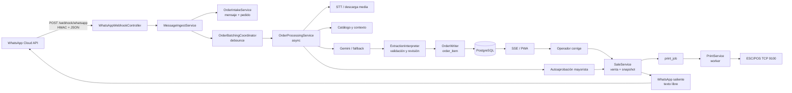

# Flujo WhatsApp → IA → pedido → venta → impresión

**Fecha:** 2026-10-25  
**Commit:** `dc5d842`  
**Objetivo:** trazar el recorrido completo de un mensaje y documentar dónde se transforma, valida, persiste, imprime y notifica, incluyendo los puntos de fallo observados.

## 1. Vista general

## 2. Recorrido detallado

### Etapa 1 — Verificación y recepción del webhook

**Componente:** `backend/src/main/java/com/fruver/interfaces/rest/WhatsAppWebhookController.java`

**Hechos:**

- `GET /webhook/whatsapp` valida `hub.mode=subscribe`, el `hub.verify_token` con comparación en tiempo constante y devuelve `hub.challenge` (`:42-53`). Si no coincide, 403.
- `POST /webhook/whatsapp` recibe el cuerpo crudo y el header `X-Hub-Signature-256` (`:55-58`).
- Rechaza cuerpos mayores a 512.000 bytes (`:59-62`).
- Calcula HMAC-SHA256 con `app.whatsapp.app-secret` y compara en tiempo constante (`:112-126`). Si el secreto está vacío o la firma falta, rechaza. Existe un bypass explícito si el secreto es `ignore`, `bypass` o `none` (`:114-116`), que `ProductionGuard` bloquea solo en perfil `prod`.
- Itera `entry[].changes[].value.contacts[]` para nombres y `value.messages[]` para contenido (`:70-76`).
- Procesa:
  - `text`: recorta a 2.000 caracteres y llama `ingestText`.
  - `audio`: `ingestAudioRef` con media id y MIME.
  - `image`: `ingestImageRef` con media id, MIME y caption.
  - cualquier otro tipo: lo convierte en `"[Mensaje de tipo X no soportado]"` y lo ingesta como texto (`:91-109`).
- No procesa `statuses`, no valida `metadata.phone_number_id` y no tiene lista de supresión/opt-out.
- Ante cualquier excepción durante el parseo o la ingesta, registra el error y **retorna 200** (`:78-82`).

**Riesgo de esta etapa:** un fallo de persistencia no se comunica a Meta, por lo que no hay reintento. Un tipo no soportado puede crear un pedido vacío si después se autoaprueba.

### Etapa 2 — Registro del mensaje y selección de pedido

**Componentes:** `MessageIngestService.java`, `OrderIntakeService.java`

**Hechos:**

- `MessageIngestService` valida teléfono (5–20 caracteres, formato permitido) y texto no vacío; recorta texto a 2.000 y nombre a 120 (`MessageIngestService.java:70-77`).
- Comprueba duplicado por `external_message_id` antes de entrar y captura `DuplicateKeyException` en carrera (`:78-90`).
- `OrderIntakeService.record` corre en una transacción corta y sin llamadas externas (`OrderIntakeService.java:32-33`).
- Crea o reutiliza el cliente por teléfono, con `ON CONFLICT (phone)`.
- Busca un pedido activo del cliente:
  - estados `RECEIVED`, `PROCESSING`, `REVIEW` dentro de las últimas 12 horas;
  - **si `autoPrintWholesale` está activo**, también incluye pedidos `APPROVED` cuyo `sale.print_status` no sea `PRINTED` (`:42-59`).
- La variable se llama `wholesaleMode`, pero en realidad es `props.printing().autoPrintWholesale()`; no comprueba `customer_type`.
- Si reutiliza un pedido con venta previa, borra `print_job`, `sale_item` y `sale` (`:63-71`) y lo devuelve a `PROCESSING/PENDING`.
- Inserta `conversation_message` con `external_message_id`; para audio/imagen agrega metadatos en `audio` o `media_image`.
- Devuelve `IntakeResult` con `orderId`, `messageId`, si es respuesta, tipo, texto, media id, storage key y MIME.
- `MessageIngestService` notifica SSE y llama a `OrderBatchingCoordinator.scheduleProcessing` si está disponible; si no, procesa de inmediato (`:91-97`).

**Punto crítico:** el borrado de venta/print_job ocurre antes de que el nuevo procesamiento de IA termine. Si el worker de impresión ya reclamó el trabajo, se produce una carrera destructiva.

### Etapa 3 — Debounce y consolidación de ráfagas

**Componente:** `OrderBatchingCoordinator.java`

**Hechos:**

- Toma el valor de `PrinterConfigService.get().customerDebounceSeconds()` si está presente y es `>= 0`; si no, cae a `props.conversation().debounceSeconds()` (`:53-60`).
- `PrinterConfigService` lee `printer_setting.customer_debounce_seconds`; V17 crea el valor por defecto **20** (`V17__ai_debounce_setting.sql:1-7`).
- Si el valor efectivo es `<= 0`, procesa inmediatamente (`:63-66`).
- Si es mayor, usa temporizadores en memoria por pedido, con un máximo de ráfaga (`debounce-max-seconds`, por defecto 90). Cada mensaje reinicia el temporizador; al vencer, envía el lote completo.
- Los temporizadores se pierden si se reinicia el proceso. `OrderProcessingService.recoverPendingExtractions` busca pedidos con `ai_status='PENDING'` al arrancar y cada 15 segundos (`OrderProcessingService.java:346-405`).
- La recuperación está pensada para reintentar; no hay una prueba específica de reinicio en medio de una ráfaga.

**Consecuencia observada:** `MultimodalBatchBurstIntegrationTest` configura `app.conversation.debounce-seconds=0`, pero el valor de la base de datos (20) tiene precedencia. `SaleFlowIntegrationTest` y `WholesaleFlowIntegrationTest` no configuran el debounce y usan el default de 20 s. En los tres casos el `await().atMost(10s)` falla. Esta misma precedencia implica que cambiar `CUSTOMER_DEBOUNCE_SECONDS` en `.env` no basta si ya existe la fila de `printer_setting`.

### Etapa 4 — Procesamiento multimodal y extracción con IA

**Componente:** `OrderProcessingService.doProcessBatch` (`:107-300`)

**Hechos:**

1. Carga todos los audios del pedido, descarga media si falta y transcribe; guarda el texto en `conversation_message` (`:108-141`).
2. Carga todas las imágenes, descarga y guarda referencias locales (`:143-170`).
3. Junta textos de mensajes entrantes del pedido (`:172-179`).
4. Si no hay texto ni imagen, retorna.
5. Ramas determinísticas:
   - saludo aislado → respuesta y estado de consulta;
   - consulta de disponibilidad/precio → respuesta de catálogo;
   - solicitud de foto de producto;
   - consulta de demora.
6. Extrae nombre y método de pago con reglas determinísticas.
7. Construye `ExtractionRequest` con texto, turnos recientes, ítems actuales si es respuesta, candidatos de catálogo, zonas y favoritos (`:242-247`).
8. Invoca `extractBatch` para varias imágenes, `extractImage` para una o `extract` para texto (`:249-258`).
9. Si la IA no está disponible, marca el pedido `FAILED` con mensaje operativo y no crea venta (`:259-266`).
10. `ExtractionInterpreter.interpret` valida la salida no confiable y asigna producto/unidad/revisión.
11. `OrderWriter.applyExtraction` persiste `order_item` y recalcula la revisión (`:268-269`).
12. Decide autoaprobación si `autoPrint` está activo (`:272-297`).

**Proveedores de IA:**

- `GeminiOrderExtractor` con pool de claves y modelos; fallback a Groq, OpenRouter, OpenCode y OpenAI (`FallbackAiClient`).
- Si Gemini falla y los fallbacks también, el pedido queda en error para digitación manual.
- `SpringAiOrderExtractor` existe como adaptador alternativo.
- No hay registro de tokens/costo por extracción en `AppMetrics`; solo tiempo y errores (`AppMetrics.java`).

**Riesgos de la etapa:**

- La IA puede devolver producto no existente; `ProductCatalogService.resolve` lo autoinscribe en el catálogo con unidad inferida (`ProductCatalogService.java:64-90`).
- La revisión puede marcar dudas, pero la rama automática no las respeta.
- El debounce reduce llamadas, pero no hay presupuesto ni cuota por cliente.

### Etapa 5 — Pedido en pantalla y corrección humana

**Componentes:** `OrderWriter`, `OrderViewService`, `SseHub`, PWA.

- `order_item` guarda lo propuesto por IA (`ai_product_name`, `ai_quantity`, etc.) y lo corregido (`product_id`, `quantity`, `unit`, `manual_price`).
- La PWA recibe cambios por SSE y muestra tablero por estado, badges de revisión e impresión.
- La edición manual usa `version` optimista y `validate` en el servidor.
- Las cantidades y precios tienen validación en frontend, backend y base de datos.
- La edición puede cambiar producto, cantidad, unidad y precio; `OrderEditService.update` exige versión.
- `OrderEditService.mergeIntoOrder` y `reopen` borran la venta si existe (ver P0-02).

**Punto positivo:** el precio final no lo decide el LLM. En la aprobación manual, `SaleService.approve` recalcula con `QuoteService`, valida la cotización y guarda snapshot en `sale_item`.

### Etapa 6A — Aprobación manual (camino esperado)

**Componente:** `SaleService.approve` (`:55-149`)

**Hechos:**

- Bloquea el pedido con `findForUpdate` y devuelve la venta existente si ya hay `sale_id` (idempotencia).
- Exige `status=REVIEW` y `version` vigente; si no, 409.
- Calcula la cotización con el tipo de precio del cliente.
- Para cliente no mayorista y `autoPrintWholesale=false`, exige cotización completa; si falta precio, unidad o producto, responde 422 con detalles.
- `isWholesale` es verdadero si el cliente es `WHOLESALE` **o** si `autoPrintWholesale=true` (`:82`). Esto mezcla “tipo de cliente” con “modo de operación”.
- Crea `sale`, `sale_item` con snapshot, actualiza `orders` a `APPROVED`, crea `print_job` y audita.
- Si no es wholesale, intenta enviar la factura por WhatsApp; cualquier excepción se ignora (`:142-146`).

### Etapa 6B — Autoaprobación (camino actual por defecto)

**Componentes:** `OrderProcessingService` y `SaleService.autoApproveWholesale`.

**Hechos:**

- `autoPrint` se lee de `printerConfig.autoPrintWholesale` o del default de propiedades (`:272-274, 305-307`).
- Si `graceSec <= 0`, llama de inmediato a `autoApproveWholesale` (`:286-288`).
- Si no, actualiza el pedido a `WAITING_FOR_MORE` y espera; un `@Scheduled` cada 10 segundos busca pedidos `REVIEW` con `ai_status='OK'` y sin mensajes recientes (`:302-343`).
- `requiresVerification` se calcula así:
  - pedido sin ítems → verdadero;
  - línea sin cantidad ni `aiQuantity` → verdadero;
  - línea ambigua sin `productId` → verdadero.
- **Aun cuando `requiresVerification` sea verdadero, llama a `autoApproveWholesale`**.
- `autoApproveWholesale`:
  - no valida estado del pedido;
  - no valida tipo de cliente;
  - no valida `quote.complete()`;
  - no valida `PRINTER_ENABLED`;
  - no valida versión;
  - crea la venta, ítems, actualiza el pedido y crea `print_job`;
  - guarda `requires_verification=true` en la venta/pedido, pero ya creó la venta.
- Cantidad ausente/no positiva se reemplaza por 1 (`SaleService.java:188-190` y `OrderWriter.java:175-177`).
- Si la cotización no está completa, el total puede quedar nulo; la base permite `sale_item.applied_price` y `subtotal` nulos desde V12 (`V12__wholesale_and_images.sql:28-32`).
- `SaleService.reprintByOrderId` puede invocar `autoApproveWholesale` si no hay venta (`:340-347`), sin comprobar el estado.

**Resultado:** con el default actual, un pedido dudoso o vacío no queda para revisión: termina en venta y comanda. La prueba `WholesaleFlowIntegrationTest.doubtfulOrderSetsVerificationFlag` confirma que el pedido se aprueba y solo verifica la bandera.

### Etapa 7 — Cola e impresión

**Componentes:** `PrintService`, `NetworkEscPosPrinter`, `EscPosEncoder`, `TicketFormatter`, `TicketService`.

**Hechos:**

1. `PrintService.tick()` corre cada `poll-ms` (por defecto 1.000 ms) y procesa la cola hasta vaciarla. Un `AtomicBoolean` evita dos workers en la misma JVM (`:47-57`).
2. `claim()` actualiza un `print_job` `PENDING` a `PRINTING` con `FOR UPDATE SKIP LOCKED`; también reclama `PRINTING` con más de 2 minutos (`:104-116`).
3. Construye el ticket desde `sale`/`sale_item`, lo codifica a ESC/POS y llama a la impresora (`:65-67`).
4. Si el socket responde, marca `print_job DONE` y `sale PRINTED` con `printed_printer` y `printed_at` (`:68-73`).
5. Si falla, reintenta hasta `max-attempts`; al agotarlos marca `FAILED` y `sale PRINT_FAILED` (`:118-133`).
6. `reprintAllPending` reencola `FAILED` y también `PRINTING` (`:83-90`); el reprint manual inserta otro `print_job` y cambia el estado a `PRINT_PENDING` (`SaleService.java:320-330`).
7. La UI muestra “IMPRESO” y “VENDIDA” cuando `sale.print_status='PRINTED'`.

**Semántica real:** el `PRINTED` se produce después de `OutputStream.write` + `flush` en TCP. No hay lectura de estado ESC/POS, confirmación de recepción, sensor de papel, corte ni apertura de cajón. Por tanto, **no se puede afirmar que la comanda salió físicamente**. La documentación que dice “al imprimirse con éxito en papel” es más fuerte que la evidencia del código.

**Carreras:**

- recepción de una adición puede borrar la venta/print_job mientras el worker tiene `PRINTING`;
- reapertura/merge borra la venta;
- reimpresión durante una impresión en curso puede encolar un segundo ticket;
- un reinicio después del `flush` puede dejar `PRINTING` y reclamarse a los 2 minutos, duplicando la salida.

### Etapa 8 — WhatsApp saliente y cierre

**Componente:** `WhatsAppCloudClient`, `ConversationService`, `SaleService`.

- `ConversationService.send`:
  - limita a 1.000 caracteres;
  - deduplica en memoria por `orderId:texto` durante 8 segundos;
  - envía texto libre;
  - si falla, guarda `delivery_status='FAILED'` y no lanza al llamador (`ConversationService.java:38-89`);
  - registra `conversation_message` y auditoría.
- `sendImage` envía imagen con URL y caption, con fallback a texto; registra el contenido como texto con el enlace.
- `SaleService.sendInvoiceWhatsApp` arma un texto con emojis, envía y registra `SENT`/`FAILED`; en la aprobación automática/manual, si es wholesale, no se llama.
- `dispatch` envía un texto de “va en camino” solo si `autoPrintWholesale=false`; captura y silencia errores.
- El endpoint manual `/api/sales/{id}/send-whatsapp` vuelve a enviar la factura.
- `DeliveryStatus.SENT` significa que el cliente HTTP recibió 2xx; no hay estado `DELIVERED`, `READ`, `FAILED` por webhook ni conciliación con Meta.

**Consecuencias:**

- fuera de la ventana de 24 h, el texto libre falla; no hay plantilla de respaldo;
- no se sabe si el cliente recibió o leyó;
- no se puede auditar el costo real;
- los emojis no son un problema de precio; el costo es por mensaje entregado y categoría.

## 3. Trazabilidad de datos

| Concepto | Tabla/campo | Observación |
|---|---|---|
| Mensaje entrante | `conversation_message.external_message_id` | Clave de idempotencia; no se guarda el payload crudo. |
| Pedido | `orders.id`, `status`, `version`, `received_at` | Estados: RECEIVED, PROCESSING, REVIEW, APPROVED, CANCELLED. |
| Línea propuesta | `order_item.ai_*` | Conserva la salida original de la IA. |
| Línea corregida | `order_item.product_id`, `quantity`, `unit`, `manual_price` | Producto puede ser nulo en la base; la UI/validación lo exige para editar. |
| Venta | `sale.order_id UNIQUE` | Snapshot comercial; se borra en reopen/merge/intake. |
| Ítem vendido | `sale_item` | `product_id` puede ser nulo desde V12; precios/totales también. |
| Trabajo de impresión | `print_job` | Estados PENDING, PRINTING, DONE, FAILED; no hay ACK físico. |
| Estado de impresión | `sale.print_status` | PRINT_PENDING, PRINTED, PRINT_FAILED. |
| Mensaje saliente | `conversation_message.delivery_status` | SENT/FAILED; no confirma entrega. |
| Auditoría | `audit_log` | Se borra con el reset global. |

## 4. Puntos de fallo y efecto observable

| Punto | Falla | Efecto actual | Cobertura |
|---|---|---|---|
| Webhook | BD caída o excepción de ingesta | 200 a Meta; mensaje no reintentado | No probado; P1-01. |
| Webhook | Tipo no soportado | Crea pedido con texto placeholder | No probado; P1-02. |
| Debounce | Valor DB 20 s pisa el 0 de test | Pruebas de flujo agotan 10 s | 12 errores; configuración. |
| IA | Salida ambigua | Se autoaprueba igual | Prueba que codifica el defecto. |
| Catálogo | Producto inventado | Se crea producto activo | No probado; P1-08. |
| Cantidad | Dato ausente | Pasa a 1 | No probado; P0-03. |
| Venta | Cotización incompleta en autoaprobar | Venta con total/precio nulos | No probado; P0-03. |
| Venta | Reapertura/anexo/adición | Borra venta y print_job | Prueba de reopen acepta el borrado; P0-02. |
| Impresión | TCP escribe y se pierde el paquete | `PRINTED` falso | No probado; P1-03. |
| Impresión | Fallo de red | Reintentos y `PRINT_FAILED` | Prueba con mock; no hardware. |
| Impresión | Reinicio en `PRINTING` | Reclamo a los 2 min; posible duplicado | No probado. |
| WhatsApp | Fuera de ventana 24 h | Fallo de envío; no hay plantilla | No probado; P1-05. |
| WhatsApp | Entrega no confirmada | UI/DB dicen SENT; no hay delivered | No probado; P1-05. |

## 5. Dictamen del flujo

El camino principal está implementado y tiene decisiones acertadas: transacciones cortas, idempotencia por mensaje, validación de precios en backend, snapshot de venta y outbox de impresión. Pero el flujo **no es confiable de extremo a extremo** por cuatro razones:

1. La confirmación del webhook no garantiza persistencia.
2. El flujo automático decide vender antes de que un humano confirme dudas.
3. La venta y la comanda pueden borrarse en operaciones normales.
4. “Impreso” y “enviado” son estados de transporte, no de resultado físico/entrega.

Para considerar el flujo listo para un piloto se necesita: webhook duradero, autoaprobación restringida y auditable, ventas inmutables, impresión con estados honestos, WhatsApp con estados/plantillas/opt-out y una prueba end-to-end con hardware y número de prueba.
